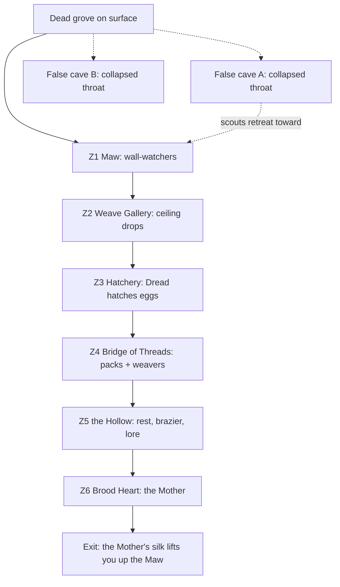

# Trials and challenges: concept (2026-10-19)

J (2026-10-19): "draft trials and challenges like a spider cave that has only one proper entrance with larger than
normal and more animated spiders that climb walls with a mother spider deeper all made of fear, I want good
conceptualization."

**Status:** concept only. There are no Blender builds and no code yet. This is a design draft for J to pick from. Builder chats take
the Blender passes later, and the mc chat takes the systems.

**Builds on what already exists:**
- `Corps.YELLOW` is "fear". Its effects already in the game are `FearEffect`, `FearFog`, `FearVignette`, `FearBlind`,
  `FearFrenzy` and `FearNuke`.
- Pass 863 has the fear-consumed mob gear: Y1 scales, Y2 lightning, Y3 dread.
- Pass 854 has the E1c stalkers. J rated E1c2 Skitter and E1c3 Unfolding Crawler IMPROVE.
- J's 845 note asked for "yellow Ender spiders teleporting in from above".
- The Yellow construct strips Y1-Y3 are in `docs/texture_library/yellow/`.

**Picture:** `cave_map.png` (next to this file), a side section of the cave drawn with Pillow.

---

## Part 1. The flagship trial: the Dread Warren (fear spider cave)

### The idea in one line

The Dread Warren is a cave that fear built. Every web, egg and spider in it is yellow hard light: a living construct
with no Lantern behind it. The only steady light inside is your own ring, and the cave wants to put it out.

### The core mechanic: Dread versus Will

Everything in the Warren runs on one meter, **Dread**, from 0 to 100. It shows as the existing `FearVignette`
tightening from the edges of the screen.

**What raises Dread:**
- standing in darkness;
- being bitten;
- seeing a spider drop from the ceiling within 4 blocks;
- the Mother's screams;
- running away (sprinting *away* from a spider that is chasing you).

**What lowers Dread:**
- standing your ground (facing a spider as it charges);
- killing spiders;
- burning webs with green light;
- lit braziers you have rekindled.

**What Dread does:**

| Dread | Effect |
|---|---|
| 0-30 | Normal. The ring light reaches its full radius (about 9 blocks). |
| 30-60 | The light radius shrinks to 6 blocks. Whispers start. Webs at the edge of your vision appear to twitch, and some of them are spiders. |
| 60-85 | The light shrinks to 4 blocks, with flicker. Egg sacs within 12 blocks start hatching. `FearFog` thickens. |
| 85-100 | The ring gutters. Every 3-5 s the light cuts out completely for half a second, and you see only the spiders' yellow glow. At 100 you get `FearBlind` for 3 s and the brood swarms. |

**The counter: Will.** A Green ring can spend charge on a **Will Flare** (the ring's existing charge, no new resource):
- Hold use with the ring arm raised (the FearNuke "constructing" pose).
- The light grows into a green sphere. On release it pulses outward over 8 blocks.
- It burns webs to drifting green ash and staggers spiders, which flip onto their backs for 1 s.
- It knocks Dread down by 25.

This turns the ring into the hero of the cave. The trial is about light being a thing you *spend*.

Other corps play it differently (see decision 2):
- **Red:** rage. Dread rises *slower* while you are attacking, but Red can't flare.
- **Blue:** hope. A slow passive Dread drain.
- **Yellow:** the brood is wary of you. Spiders hesitate, but the Mother hates you more.

### Finding it: one true entrance

- **Where:** it generates rarely, buried in deepslate under dark forests, old-growth spruce taigas and swamps. That puts it near
  y -20 to -50, under the surface.
- **The tell on the surface:** a dead patch. The grass is grey, and there is a ring of trees with yellow cobweb-light threads strung
  between their trunks that glint only at night. Cattle and villagers won't walk through it.
- **The true entrance, the Maw:**
  - a sinkhole in the middle of the dead patch, 5 blocks wide;
  - its rim is ringed with hard-light silk curling *inward* like eyelashes;
  - a spiral of webbed ledges leads down the shaft.
  - It's the only way in that leads to the nest.
- **The false entrances:**
  - 2-3 other openings on hillsides nearby, which look like normal caves with old webs.
  - Each goes 15-30 blocks and ends in a **collapsed throat**: rubble choked with yellow silk.
  - Behind the silk you can hear skittering, but you can't get through. Mining the rubble just collapses more on you,
    and the silk regrows behind you.
  - The lesson: fear lies about where the way in is. These false caves are also where the first scouts find you and
    retreat, *pulling you toward* the Maw.
- **Anti-cheese:**
  - The Warren's blocks are **Dread Stone**, deepslate soaked in fear. You can mine it, but slowly (like obsidian), and
    it **regrows** from the walls in 30 s.
  - Tunnelling straight down to the Mother does work, but you arrive in the arena at Dread 100 with the whole brood
    awake.
  - So the honest path is the fast path.

### Layout: from the Maw to the nest

The cave is a descending chain of **zones**. Each zone teaches one spider behaviour, then the next zone combines it with
the earlier ones. Total depth is about 60 blocks. A careful first run takes about 20-25 minutes.

```
 SURFACE   dead grove        ~ ~ ~ ~ (false cave A)  ...rubble+silk X
 ------------\      /------------------------------------------------------
              \MAW /   Z1  the Maw: spiral ledges down the shaft, web curtains
               |  |        lesson: spiders ON WALLS (they watch, they don't attack)
               |  |____
                \      \__ Z2  the Weave Gallery: tall hall, webs floor to ceiling
                 \________\    lesson: CEILING DROPS (shadows above you)
                        ||
                 _______||_____  Z3  the Hatchery: low wide room, egg sacs in the walls
                /  o  o   o  o \     lesson: HATCHING (Dread makes eggs burst)
                \______________/
                        ||
            ____________||________  Z4  the Bridge of Threads: a chasm, hard-light silk bridges
           |  ~~~~~ abyss ~~~~~   |    lesson: PACKS + WEAVERS (spiders cut the bridges)
           |______________________|
                        ||
                   _____||_____   Z5  the Hollow (rest): a dead Lantern-bearer's camp, a brazier to rekindle
                  |   (*)  ⌂   |      no spiders; checkpoint; lore
                  |____________|
                        ||
          ______________||______________
         /   ^^^^ web dome ceiling ^^^^   \   Z6  the Brood Heart: domed arena, 30 blocks across
        |       . . MOTHER . .             |      the Mother hangs in the dome
        |   pillars        pillars         |
         \__________(heart-crystal)_______/
```



#### Z1: the Maw (descent, 15 blocks)

- **Shape:** a spiral of ledges round a shaft, with web curtains you push through. Each curtain parts like a bead
  curtain and glows briefly where you touched it.
- **Light:** daylight from the sinkhole fades over the first 10 blocks. By the bottom the ring is the only light.
- **The beat:**
  - Spiders are already on the walls *across the shaft*, motionless, eyes lit.
  - When your ring light reaches one, it skitters out of the light, round the shaft wall, and stops again just at
    the edge.
  - They never attack here. They escort you down.
- **Lesson:** spiders climb walls and they don't like your light.

#### Z2: the Weave Gallery (tall hall, 25 tall)

- **Shape:** a long nave with webs strung floor to ceiling like stained glass. The silk is yellow, with slow-gliding
  Y3 dread texture.
- **The beat:**
  - You hear skittering *above*. Shadows of legs slide across the webs you're lit through. That shadow is
    projected from your own ring light, so it only happens because you're carrying the light.
  - Then the first **drop**: a Hunter lets go of the ceiling and falls on a silk thread. It stops 2 blocks above
    your head, hanging upside-down, and stays there for one beat. Then it drops the rest of the way and attacks.
- **Lesson:** look up.

#### Z3: the Hatchery (low wide room)

- **Shape:** a ceiling only 4 blocks high. The walls are honeycombed with **egg sacs**: translucent yellow pods with
  a curled spiderling silhouette inside, pulsing with your heartbeat sound.
- **The beat:**
  - The eggs respond to Dread. While it's under 40 they sleep.
  - Over 40, the nearest ones crack: light leaks out of the cracks first (the gold-crack language from the lantern),
    then broodlings pour out.
  - A Will Flare *can* burn eggs before they hatch, so this is where players learn to spend light to save trouble
    later.
- **Lesson:** your fear feeds the nest.

#### Z4: the Bridge of Threads (chasm)

- **Shape:** a black abyss with no bottom you can see (a fall into it lands in a web net 20 blocks down, at Dread
  +40). The only way across is **hard-light silk bridges**: thick braided strands sagging like rope bridges, glowing
  faintly.
- **The beat:**
  - **Weavers** (see below) cling under the bridges. They cut strands behind you and spin new ones ahead in the
    wrong direction.
  - A **pack** of Hunters comes along the cave walls on either side, moving faster than you can on the bridge.
  - A Green ring can build its own Bridge construct here. That is a deliberate answer, and it costs charge you
    may want for the Mother.
- **Lesson:** packs, flanking, and the cave changing under you.

#### Z5: the Hollow (rest)

- **Shape:** a small dry chamber with no webs.
  - **The camp:** a long-dead Lantern-bearer's camp, a bedroll and a cold brazier.
  - **The ring:** a cracked ring lies in the bedroll. It's a plain grey ring, not a Corps one.
  - **The book:** a journal of 4 pages, ending mid-sentence.
- **The beat:**
  - Rekindling the brazier with the ring sets a **checkpoint**: you respawn here if you die further in. Dread
    resets to 0.
  - It's the only silence in the trial. The music drops out completely and you hear only distant breathing.
- **Purpose:** pacing. You need the exhale before the boss.

#### Z6: the Brood Heart (boss arena)

- **Shape:** a dome 30 blocks across and 20 high.
  - **The ceiling:** one huge web, sagging like a tent.
  - **The pillars:** eight around the edge. They are pillars of fused silk with old prey cocooned in them: villagers
    and an iron golem, shapes you can just make out.
  - **The heart-crystal:** in the middle of the floor, a pulsing yellow crystal half-buried in the stone. This is the
    nest's "lantern", the thing all this fear is charged from.
- **The beat:** on entering, the brazier light behind you goes out, the exit seals with silk, and the Mother is
  revealed (see her section).

### How the cave reads visually

- **Darkness is the canvas.**
  - Dread Stone is near-black deepslate with faint yellow veining, like the lantern's gold lightning cracks. The
    cracks pulse very slowly (frametime 5, loops of 8-10 s), per J's construct rule "never static, but not fast".
  - Nothing in the cave emits block light except the heart-crystal, the rekindled brazier, and the faintly glowing
    silk (light level 1-2, enough to outline and no more).
- **The ring is the lamp.** The ring casts real block light with a radius set by Dread (the 860 rule: block light that
  lights the vicinity and fades, never screen-space rays). This is the most important visual in the trial: J's green
  light pushing into a yellow world.
- **Hard-light silk.**
  - Strands are thin, readable lines, never faint particles. J rejected faint particles for beams; same rule.
  - Each strand is a dark core with saturated yellow edges, 70-90% opaque.
  - Thick strands use a slow Y1 scale texture gliding along their length.
  - Sheets of web are translucent panes, which the ring light catches and sends glinting.
- **Burnt silk.** When green light burns a web, it disintegrates pixel by pixel into falling green-and-yellow ash. This
  is J's loved "cover disintegrating" language.
- **Dread fog.** Low, ground-hugging yellow-grey fog that thickens with Dread (`FearFog`, but layered in the cave).
- **Colour discipline.** Yellow = them, green = you. Nothing in the cave is green except what your ring does.

### The spiders: the Brood

All of them are fear constructs:
- **Bodies:** hard-light shells (Y1/Y3 looks) over a dark core, with darker undersides.
- **Glow:** eyes and joints glow.
- **Death:** they don't bleed. They crack, the light gutters out, and they crumble into silk ash.

**How they move matters more than how they look.** J's E1c note was "animations for movement", and the request says
"more animated".

| Type | Size (vanilla spider = 1x) | Role | Movement and behaviour |
|---|---|---|---|
| **Broodling** | 0.5x | swarm, from eggs | Fast twitchy bursts, then freeze (the E1c "step-step-freeze" read). Comes in groups of 6-12. Weak alone; the danger is that they raise Dread fast. |
| **Hunter** | 1.6x (2.2 blocks across) | the main fighter | Walls and ceilings. Drops on a thread. Leaps 6 blocks at the player from a wall. Circles at the edge of the light before committing. |
| **Weaver** | 1.3x, long thin legs | support | Stays out of reach. Spits silk that slows you (vanilla cobweb, but a hard-light one that a Will Flare burns). Cuts and spins bridges. Rebuilds webs you burned. |
| **Stalker** | 2.5x, stilt legs (from E1c2/E1c3) | mini-boss in Z4 | Tall and slow, always facing you. Unfolds from a folded crouch (E1c3). Only one per run. |
| **Dread Phantom** | 1.0x, translucent | ambush (J's "Ender spiders teleporting in from above") | Blinks in from the ceiling darkness in a puff of yellow static, right behind you. Only spawns when Dread is over 60. |

**The animation language (the "more animated" part):**
- **Legs that plant.**
  - Each leg has its own foot target on the surface (wall, floor or ceiling).
  - The body glides while legs step in alternating sets of four, 1-3 at a time, like a real spider.
  - Feet stay pinned to the block until they lift. This is procedural leg IK, done in code at render time (see
    Part 4), not baked loops, so they cling to any wall shape.
- **Body sway and bob** on each step, and the abdomen lags behind the body a little (secondary motion).
- **Idle twitches:**
  - A leg tests the ground.
  - Pedipalps clean the fangs.
  - The abdomen breathes light: it brightens and dims on a 3 s cycle.
- **Stillness, then sudden motion.** This is the 854 scary rule. Spiders freeze completely when looked at directly
  (like they're unsure), then burst into motion when you look away, or the moment your light flickers.
- **Ceiling drop:** let go, fall on a silk thread that visibly pays out from the spinnerets, stop with a bounce, rotate
  to hang upside-down, then drop onto the target.
- **Turning on a corner:** when a Hunter walks from the floor onto the wall, its body rolls 90 degrees over 4-6 ticks,
  legs reaching ahead to grab the new surface first.
- **Pack behaviour:**
  - Hunters stalk at the light's edge and rotate positions round you.
  - One feints from the front while another drops from behind.
  - If one Hunter is killed in a Will Flare, the others retreat into the dark for 3 s. They fear the green too.
- **Death:**
  - The legs curl inward (the real-spider death pose).
  - The body light gutters out from the abdomen forward.
  - Then the shell cracks along its plates and crumbles.

### The Mother: the Brood Matron

- **Scale:** a 7-block leg span; the body is the size of a horse.
- **Silhouette:**
  - a swollen, lantern-shaped abdomen;
  - the abdomen's glass-like shell is crazed with gold lightning, like a broken Power Battery made of fear;
  - you can see broodlings moving inside it.
- **The idea:** she *is* the nest's lantern. She is fear that learned to make more of itself.
- **The head:**
  - It has a crown of eyes. Eight of them glow, and two are dark and empty.
  - Her front legs are long and scythe-like, held folded like a mantis until she strikes.
- **The voice:** she doesn't hiss. She *whispers*: a layered, reversed-whisper sound. Her biggest attack is a scream that
  pushes Dread up by 30.

**The arena (Z6) is designed around her:** the dome web is her territory, the pillars are cover (and her
perches), and the heart-crystal is her weakness.

**Phase 1: "She is above you"** (100-70% health)
- She stays on the dome ceiling. You see her only as moving shadows on the web and as eight lights.
- She **drops broodlings** in clumps, and **drops herself** at you on a thread, striking with her scythes and
  climbing back up within 2 s.
- To hurt her: hit her while she's down. Or **burn the dome web** with Will Flares or beams: each burnt section is
  ceiling she can no longer walk on.
- Burning about 50% of the dome forces phase 2.

**Phase 2: "She comes down"** (70-35%)
- With not enough ceiling left, she falls to the floor and fights on the ground and the pillars.
- She **spins silk walls** across the arena to split it into lanes (these are fear constructs; Green Wall constructs
  can block them).
- She **cocoons**: one hit from her web shot wraps you. Break out by mashing use (each press flares the ring), or let
  a teammate cut you free.
- Her egg sacs on the pillars hatch whenever Dread is over 60.
- She **feeds on fear**: if a player is at Dread 85+, she heals by draining it from them, shown as a yellow stream from
  player to her abdomen. This is the moment the trial's mechanic pays off. Players who kept their Dread low starve
  her.

**Phase 3: "Lights out"** (35-0%)
- She screams and puts out **every light**:
  - the ring goes dark (it can't be relit for 5 s);
  - your screen goes to `FearBlind`;
  - the only things visible are her glowing abdomen and the heart-crystal.
- She hunts in the dark, and the spiders' eyes are all you see.
- **The counter is will:**
  - Standing still and holding use for 3 s reignites the ring by force: a big green burst, the "charge starting"
    dissolve J loves.
  - The ring then burns *brighter than before* for 10 s: a full overcharge.
  - In that window her shell cracks open where the gold lightning is.
- **The finish:**
  - Get a **Will Flare** or a melee hit to land in the cracked abdomen; that makes her collapse.
  - Then **plunge the ring into the heart-crystal**: hold use while standing on it, a 3 s channel. While you channel,
    the remaining spiders rush you and your teammates defend you.
  - The crystal turns from yellow to green from the inside out, the whole web dome burns in a wave, and every
    spider in the cave crumbles at once.

**After:**
- The nest is silent. A green light now pulses where the yellow crystal was.
- The Mother's last silk thread lowers from the dome, and grabbing it lifts you up a hidden shaft to the surface. That
  is the second exit, and it only exists once she's dead.
- The dead grove on the surface regrows over the next day.

### Sound and pacing beats

| Beat | Sound | Music |
|---|---|---|
| Surface dead grove | wind, no birds, a faint high whine near the threads | none |
| Z1 descent | your footsteps echo; distant skitters, too many legs, too fast | low drone fades in |
| First wall-watcher seen | one sharp dry click, then silence | drone holds |
| Z2 ceiling shadows | skittering directly above, panning across | heartbeat pulse joins |
| First drop | the thread *zips*, a creak as it stops, then nothing for one beat | everything cuts to silence for that beat, then a stab |
| Z3 Hatchery | eggs pulse in time with your heartbeat; it speeds up with Dread | heartbeat leads |
| Z4 bridge | strands creaking under your weight, snaps as they're cut | percussion of legs |
| Z5 the Hollow | true silence, then distant breathing | silence (the exhale) |
| Z6 reveal | the brazier hisses out, the Mother's whisper from every direction | full theme |
| Phase 3 lights out | all sound muffles to a low ring, as if underwater; only her whisper is clear | music drops out |
| Ring relit | a rising green charge tone (the lantern charge sound) | the theme returns in a major key |
| Heart-crystal turns green | a long glassy resonance, webs crackling as they burn | resolve |

**Pacing rule:** every scare is preceded by a quiet beat. The cave is mostly *tension*; actual fights are short and
sharp. That matches J's "fast and snappy" feel: no wind-ups, instant reactions.

### Rewards

- **Dread Silk** (material): drops from spiders, about 1-3 each. It's crafted into Ring Lab cosmetics and the items
  below.
- **Brood Heart Shard** (one per clear): the boss reward. It unlocks the following.

| Reward | What it does | Where |
|---|---|---|
| **Will Flare** (permanent) | The cave's Will Flare becomes a normal Green ring mode outside the trial: a light-pulse that clears webs and fear effects round you, and staggers mobs. | new RingMode |
| **Wallcrawl** | Construct claws let you climb walls (like the Hunters). Hold jump against a wall. | flight/movement upgrade |
| **Silkline** | A Tether variant: a hard-light thread to a ceiling or wall that you swing on or pull yourself up by. | Tether upgrade |
| **Dread Sight** | Briefly see fear-consumed and Yellow entities through walls (a yellow outline). | ring passive |
| **Silk construct look** | A new construct texture, the "W1 weave" language spun as web, unlocked in Green too. | Ring Lab > Constructs |
| **Matron trophy** | A Blockbench lantern-shaped trophy of her abdomen, which glows green now. | block |

---

## Part 2. Six more trials (round 2)

J on round 1 (2026-10-19): "Need better ideas". The first six were "a dungeon per colour with a meter". They were
dropped because they were the same shape six times: a meter, three zones and a boss. The round-1 one-liners are parked
at the end of this part.

Round 2 rule: every trial is built around **one set-piece moment** players will describe to friends, and it changes
**what the ring does** instead of adding a new meter.

Each pitch below has the same four headings:
- **Hook:** one sentence.
- **Set piece:** the moment players remember.
- **Ring twist:** how ring powers change in it.
- **Why it's memorable.**

### ★ 1. The Fallen Titan: Green, will (a valley in old-growth forest or badlands)

- **Hook:** a dead Lantern's last construct, a 60-block hard-light giant, lies face-down across a valley. You climb
  inside it, wake it, and take its controls.
- **Set piece:**
  - The last room is the Titan's head.
  - You put your ring into an empty socket and the whole giant wakes.
  - The Titan gets up off the valley floor in one long take, and the trees fall off its back.
  - Then you pilot it against what killed its owner: a fear storm crawling over the hills (a yellow construct swarm,
    with the Warren's Matron as an echo).
- **Ring twist:**
  - Your constructs become the Titan's repairs. The giant is cracked and dark inside, and every Bridge or Wall you
    build *inside* it reconnects a broken limb and lights it green again.
  - The order you repair it in changes the final fight. Fix the arms first and you punch; fix the legs first and you
    can run.
- **Why it's memorable:**
  - You go from ant to giant in one trial: a dungeon *inside* a construct, then you *are* the construct.
  - It builds on J's mech pick (843 MAa: "Give this bot the hammer and make it for the villagers").
- **Shape:**
  - the boot (the entry, half sunk in mud);
  - the leg (a vertical climb up a hollow shin);
  - the chest cavity (the dead lantern-heart; re-light it);
  - the arm (a broken bridge you construct back together);
  - the head (the socket, then the pilot fight).
- **Rewards:**
  - **Titan Call:** once a day, summon a 12-block construct giant for 30 s.
  - The giant's construct look.
- **Build cost:**
  - the hardest model (the giant, in parts) and a large structure;
  - **piloting** is a ridden entity with scaled inputs; the mechs give a start.

### 2. The Falling Citadel: Green, will (in the sky above any biome)

- **Hook:** a corps fortress breaks loose at build height and falls. You have the length of the fall to reach its
  core, before it hits the ground and the world below.
- **Set piece:**
  - The whole trial is a **10-minute descent**. The citadel tilts, and rooms break off and fall past you.
  - The ground gets closer through every window, and the clouds go by.
  - At the core you choose:
    - **slow it with a Dome under it:** the ring drains to zero, and the citadel lands as a ruin you can explore;
    - **leap off at the last second:** it hits, and leaves a crater of chunks 4x the FearNuke's crater.
- **Ring twist:**
  - Flight is the main tool, and it's fighting you. The citadel's fall drags you down (the fall-speed field), so
    your flight is weakest inside.
  - Bridges between falling halves only last as long as the halves stay together.
- **Why it's memorable:**
  - A countdown you can *see*: the ground rising in every window.
  - The ending is a crater in the player's own world, a scar they can visit forever.
- **Rewards:**
  - **Skyfall:** dive from height and land in a ring-shock crater, using J's landing language.
  - The citadel ruin itself as a base.
- **Build cost:**
  - Moving a whole structure is the risky part. It could be done as blocks moving in chunks (risky) or as a big
    display-entity model (cheaper).
  - The research chat's physics survey matters here.

### 3. The Robbed Ring: Orange, avarice (a buried vault under badlands)

- **Hook:** the Hoarder's vault doesn't steal your loot: it steals **your ring's powers, one mode at a time**, and
  you have to win them back from the vault's guardians.
- **Set piece:**
  - The finale is the Hoarder wearing everything it took:
    - your Blast as its fists;
    - your Wall as its shield;
    - your flight as wings, all in *your* Ring Lab looks.
  - Each hit you land knocks one of your powers loose as a glowing orb. Grabbing it gives you that mode back, mid
    fight.
- **Ring twist:**
  - The trial strips the ring. At the door the vault takes flight. Every room takes another mode (Blast, then
    Beam, then Wall).
  - By the bottom you have only one power left, and you have to solve rooms with *just* that.
  - Players learn what each mode can really do.
- **Why it's memorable:**
  - Your own build is turned against you, so every player's boss fight is different.
  - Winning powers back one by one in the finale feels like a comeback.
- **Rewards:**
  - **Steal** and **Hoard** upgrades (take one buff off a mob).
  - The Orange construct look. This trial would force the Orange pick, which is still unpicked.
- **Build cost:**
  - Mostly code and rooms. The Hoarder is one model wearing construct copies of existing effects.
  - Cheap for its impact.

### 4. The Frozen Hour: Red, rage (a ruined village in a savanna)

- **Hook:** a battle frozen at its worst second: raiders mid-swing, arrows hanging in the air, a house mid-explosion.
  Your rage is the only thing that makes time move.
- **Set piece:**
  - You walk *through* a frozen explosion: blocks hanging in a fireball, debris you can climb like stairs.
  - Then you hit the bomb at its centre. Time restarts around you in a 10-block bubble, and the explosion finishes
    *in front of you*, at a tenth of its speed.
- **Ring twist:**
  - Rage (attacking) unfreezes time near you. Calm refreezes it.
  - Arrows only move when you're fighting, so you move hanging arrows out of a villager's path while you're calm,
    then fight to let them fly at the raiders.
  - The Red ring's Blast becomes a way to *push time forward* in one spot.
- **Why it's memorable:**
  - A frozen battlefield is a striking picture, and a puzzle: every room is a moment you rearrange.
  - Saving the villagers frozen in the frozen fight is the goal. If you save them, the village exists afterwards.
- **Rewards:**
  - **Rage Surge:** a short bullet-time window for Red rings (everything near you at half speed for 3 s).
  - The saved village becomes a Red corps outpost.
- **Build cost:**
  - Frozen mobs and projectiles are server-side tick freezing inside a region. That's moderate and well-trodden
    (no physics).

### 5. Night of the Yellow Moon: Yellow, fear (a world event at the player's village)

- **Hook:** once the Warren is cleared, the moon turns yellow. Fear comes to *your* village: fear-consumed mobs in the
  863 armour, construct weapons, and the Matron's surviving brood.
- **Set piece:**
  - The siege's last wave is a **fear mech**: a yellow construct walker piloted by a fear-consumed villager (the
    843 mech turned against you).
  - At the same time, the villagers you armed come out with green construct weapons and a mech of their own.
  - Two mechs fight in your streets.
- **Ring twist:**
  - It's the only trial where the ring **arms other people**.
  - You give villagers construct weapons (the same ones FearFrenzy gives mobs, in green) and build walls round their
    houses, before and during the siege.
  - How well you prepared decides the night.
- **Why it's memorable:**
  - It happens *at home*, to villagers the player knows.
  - It uses almost everything that already exists: `FearFrenzy`, `FearFog`, the 863 gear, the mechs. So it's the
    cheapest big trial to build.
- **Rewards:**
  - The village's **Lantern-guard** villagers (armed with green constructs, permanent).
  - A green-moon night once a month where mobs avoid the village.
- **Build cost:**
  - Mostly event and AI work, plus the mech skins. The lowest risk of the six.

### 6. The Echo Duel: Violet, love (an amethyst geode chapel)

- **Hook:** a crystal chapel that loves you so much it makes a copy of you, which replays every move you made on
  your way down, and waits for you at the altar.
- **Set piece:**
  - The duel is against **your own recording**: the Echo uses your exact path, your exact attacks and your Ring Lab
    looks, timed as you did them, in violet.
  - Halfway through it *learns*: it starts dodging the attack you used most.
  - In multiplayer, each player fights a teammate's echo.
- **Ring twist:**
  - Your play style becomes the boss.
  - Players who spammed Blast on the way down face a Blast monster.
  - Players who were clever with Walls face a fortress.
  - The Crystal Prison is the counter: freeze the Echo mid-replay, and the replay breaks.
- **Why it's memorable:**
  - "I fought myself and lost to my own habit" is a story every player tells differently.
- **Rewards:**
  - **Echo:** a construct copy of you that repeats your last 3 s of attacks.
  - The V1 crystal and V3 silk looks.
- **Build cost:**
  - Recording the player's inputs and positions on the way down, then replaying them through a player-shaped
    entity.
  - It's moderate work; the "learning" is a simple counter.

### Parked from round 1 (one line each)

- **Bloodfurnace (Red):** stand still and the lava rises. Its "rage you must control" idea moved into the Frozen Hour.
- **Drowned Light (Blue):** escort lost lights through the deep ocean. It's an escort mission and too slow. Parked
  until Blue's kit is settled.
- **Mirror Garden (Violet):** its crystal copies became the Echo Duel.
- **Hoard Vault (Orange):** the weight meter became the Robbed Ring.
- **Oath Spire (Green):** a climb with limited charge. Its Oath moment can be the Fallen Titan's socket scene instead.
- **Ender Brood (Yellow):** teleporting Dread Phantoms stay in the Warren. The End arena became Night of the Yellow
  Moon.

---

## Part 3. How trials fit the mod

### Triggers: how a player finds a trial

- **The lantern calls you.**
  - Once a player's ring has been charged 5 times at the Power Battery, the lantern shows a faint **compass flicker**.
  - Right-click the lantern while sneaking: the lantern's flare points in the direction of the nearest trial for
    3 s.
  - That's lore-friendly: the light *knows* where its enemies are.
- **Structures are worldgen.** Each trial is a rare structure in its biome, found by exploring or by the lantern hint.
- **Ring Lab > Trials tab:**
  - lists trials found, cleared and best time;
  - lets J **teleport into a test copy** of any trial for tuning (like the existing test menus).

### Difficulty

- **The ring's power level** decides the danger: charge cap, number of upgrades, the Dread rise rate.
- **Hard mode:**
  - Repeat clears unlock a "Deep" variant: more spiders and the Mother's phase 3 is longer.
  - Rewards are cosmetics: corrupted variants of the construct looks.
- **RingTuning entries** for every timing and threshold: the Dread rise rates, the light radii, the Mother's health,
  the regrowth time. J tunes them in the Ring Lab, as with every other power.

### Multiplayer

- **Dread is personal; the nest is shared.** Each player has their own Dread meter, but eggs hatch from the *highest*
  Dread in range. So a scared teammate is a danger to everyone. That's good drama.
- **Teammate actions:**
  - **Cut free:** cocooned players are freed by a teammate's hit.
  - **Calm:** standing next to a player at high Dread slowly lowers it (the "you're not alone" mechanic).
- **Scaling:** spider counts are ×1.0 / ×1.6 / ×2.1 / ×2.5 for 1/2/3/4 players. The Mother's health scales the same.
- **One clear per world:** the boss can be killed once per Warren, and each player who was in the arena gets their
  shard.
- **Mixed corps:**
  - A party of Green, Red and Blue plays the cave together, each with their own counter (flare / rage resistance /
    calm).
  - That gives a reason to party up across corps.

---

## Part 4. What it would take to build

### Blender passes (builder chats; numbers set by the coordinator as v2.01xx)

| Pass (proposed) | Area | What | Notes |
|---|---|---|---|
| Spider body round 1 | `combat\` | Broodling, Hunter, Weaver, Phantom: 3 takes each, voxel, Y1/Y3 shells | Builds on the 854 E1c2 skitter (IMPROVE). Legs must be **separate segment parts** (coxa, femur, tibia, tarsus) so code can do IK. |
| Spider motion round | `combat\` | walk cycle reference, wall turn, ceiling drop on thread, idle twitches, pounce, death curl | Blender is the **reference**. The game runs legs procedurally; Blender sets the timing and the pose targets. |
| Stalker | `combat\` | E1c2/E1c3 IMPROVE round, merged into the cave Stalker | J already wants this round. |
| The Matron | `combat\` | 3 silhouette takes, then phases: ceiling drop, scythe strike, silk shot, scream, lights-out, collapse | The biggest model. Keep it near 2,500 boxes. |
| Cave kit | `constructs\` | silk strands (thin/thick), web sheets, egg sacs (sleeping/cracking/hatched), Dread Stone, pillars with cocoons, heart-crystal (yellow → green) | Silk and web textures: a new Y4 strip in the construct-texture tools. |
| Cave mock-up | `constructs\` | a greybox fly-through of Z1-Z6, rendered first-person with ring light as the only light | It lets J judge the *mood* before anything is built in game. |
| Will Flare | `combat\` | 3 takes of the hold-and-pulse, first and third person | It reuses the FearNuke constructing pose. |
| Rewards | various | Silkline thread, Wallcrawl claws, Matron trophy | later |

### Minecraft systems (mc chat)

1. **The structure:**
   - a jigsaw structure: template pools for each zone, so the Warren varies between worlds;
   - placed with `terrain_adaptation: bury` (or `encapsulate`) so cave carvers don't open extra entrances;
   - zone NBTs built in game or generated by a script;
   - false entrances as separate small structures within 40 blocks.
2. **Blocks:**
   - Dread Stone (slow to mine, regrows);
   - Fear Silk (hard-light web, slows, burnt by green light);
   - Silk Bridge (a walkable strand block);
   - Egg Sac (hatch on Dread);
   - Heart-Crystal (block entity, the boss trigger);
   - Brazier (checkpoint).
3. **The Dread system:**
   - a per-player attachment (0-100) synced to the client;
   - it drives the existing `FearVignette`, `FearFog` and `FearBlind`;
   - a cave-only region check (the structure's bounding box).
4. **Ring light:**
   - **The cheap route:** place and remove invisible `minecraft:light` blocks round the player each few ticks. The mod
     already does block light for beams.
   - **The nicer route:** a dynamic-lights mod (below).
5. **Entities:**
   - five spider entities and the Matron;
   - custom AI goals: edge-of-light stalking, ceiling drop, pack flank, feed-on-fear, silk walls.
6. **Wall and ceiling climbing.** This is the hardest part. It's **on hold** until J has seen Stormie's Spiders
   (decision 2):
   - **Stage A (cheap, walls only):** vanilla `Spider`-style climbing (`WallClimberNavigation` plus the climbing
     flag). It climbs vertical walls but can't walk on ceilings.
   - **Stage B (real):** a custom movement controller where each spider has a "surface normal". Gravity points into
     the surface it's on, collision runs in that frame, and the renderer rotates the model to the normal. Pathing on
     3D surfaces needs its own small navigator (block-face graph), because vanilla pathfinding is 2D-ish.
   - Ceiling drops are easier than ceiling walking. Spawn spiders on the ceiling, let them hang and drop, and fake the
     rest. That gets 80% of the look for 20% of the work.
7. **Procedural leg IK (client renderer):**
   - each leg raycasts for a foot target near its rest position;
   - it steps when the target is more than about 0.6 of a leg-length away (alternating sets);
   - two-bone IK solves the knee;
   - feet lerp in an arc. That makes spiders cling to any surface shape.
8. **The boss arena:** a phase controller, a dome web made of breakable silk blocks (phase 1 → 2), a lights-out phase
   (a client effect), and the heart-crystal channel.
9. **Sounds:** about 20 new sound events (skitters, thread zip, whisper, scream, egg pulse, silk burn, crystal turning).

### Mods that could help (check 26.3 availability before relying on any)

- **GeckoLib:** animated entity models with bone animation from Blockbench. Good for the Matron's phases and the
  spiders' body animation, and procedural IK can still drive individual leg bones. This is the biggest time-saver if
  it's on 26.3.
- **LambDynamicLights** (Fabric): held-item and entity dynamic lighting. It would make the ring a real moving light
  without placing light blocks. It has to be a soft dependency, since J plays in Lunar.
- **YUNG's API / Lithostitched:** helpers for jigsaw structures and worldgen tweaks.
- **The "Spiders 2.0" mod** (older Forge): a well-known reference for wall/ceiling walking spiders with orientation. Use
  it as reference for the approach only; check its licence before borrowing any code.
- **Stormie's Spiders** (modrinth.com/mod/stormies-spiders): J asked to see what it can do before any ceiling
  walking is designed (decision 2). The research chat is documenting it.
- The research chat's survey (`docs/research/2026-10-19-mods-physics.md`) was **not in the repo yet** when this was
  written. Fold its picks in here when it lands.

### Risky parts (in order)

1. **Ceiling walking with collision and pathing.** This is the riskiest system. Start with Stage A plus ceiling *drops*,
   and only build Stage B if J wants spiders running across ceilings in game.
2. **Procedural IK performance.** It's client-only, and fine for about 20 spiders. Cap spiders per zone, and skip IK on
   spiders over 32 blocks away (use a baked walk loop instead).
3. **The one-entrance guarantee against worldgen caves.** Bury plus a protective shell of Dread Stone round the
   structure should do it. Test with many seeds.
4. **The ring-light approach.** The light-block route can flicker on fast movement and costs lighting updates. A
   dynamic-lights mod is nicer but optional. Test both in Lunar with Complementary.
5. **Lights-out in shaders.** Complementary may brighten caves on its own. Check that phase 3 still reads as darkness in
   J's setup.
6. **Jar size (now near 30 MB).** Five spider models, the Matron, a cave kit and sounds will push it. Paletted
   textures, short OGG sounds, and maybe a separate "Trials" resource download.
7. **Scope.** The Warren alone is a large feature. Suggested order:
   - the Dread meter plus the Hatchery-style egg room as a playable vertical slice;
   - then the Hunter with drops;
   - then the full cave;
   - then the Matron.

---

## Decisions (J, 2026-10-19)

All answered. Climbing is on hold for the Stormie's Spiders test world.

1. **Who can enter the Warren:** "Any corps ★". Every corps can enter, each with its own counter: Green flares, Red
   resists while attacking, Blue drains Dread, and Yellow gets a wary brood but a furious Matron.
2. **Wall-climbing: ON HOLD.**
   - J: "show me the extent of stormies spiders before creating ceiling walking".
   - Stage A or B is not chosen yet. Climbing waits on the research chat's write-up of what **Stormie's Spiders**
     (modrinth.com/mod/stormies-spiders) can do.
   - If it already does wall and ceiling walking on 26.3 (or its approach can be reused), Stage B may come cheap.
   - Don't build any climbing code or climbing animations before J has seen that.
3. **Next trial after the Warren:** "Fallen Titan ★" (from the round-2 pitches in Part 2). It is next after the
   Warren.
4. **Climbing (follow-up):** "Watch it first ★". The research chat sets up a Stormie's Spiders test world for J. The
   Stage A/B choice waits until J has watched it.
